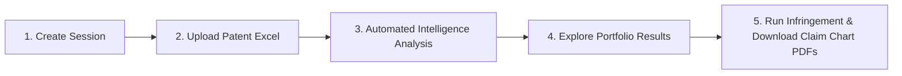

# Portfolio Analysis & Patent Intelligence Platform — User Guide

## Table of Contents
1. [Overview](#1-overview)
2. [End-to-End Workflow](#2-end-to-end-workflow)
3. [Step 1: Create and Manage a Session](#3-step-1-create-and-manage-a-session)
4. [Step 2: Upload Your Patent List (Excel)](#4-step-2-upload-your-patent-list-excel)
5. [Step 3: Portfolio Processing & Real-Time Progress](#5-step-3-portfolio-processing--real-time-progress)
6. [Step 4: Explore Your Portfolio Results](#6-step-4-explore-your-portfolio-results)
   - 6.1 Portfolio Overview Table
   - 6.2 Patent Abstract
   - 6.3 Technology Classification
   - 6.4 Relevance-Ranked Assignees (Competitor Intelligence)
   - 6.5 KYP Rank, Valuation Score & Classifications
   - 6.6 Citations (Forward & Backward)
7. [Step 5: Infringement Analysis & Claim Charts](#7-step-5-infringement-analysis--claim-charts)
   - 7.1 Running Infringement Analysis on a Patent
   - 7.2 Novelty Summary
   - 7.3 Discovered Infringing Products
   - 7.4 Selecting Products & Generating Claim Charts
   - 7.5 Viewing the Element-by-Element Claim Chart
   - 7.6 Downloading Courtroom-Ready PDF Reports
8. [Exporting Portfolio Data to Excel](#8-exporting-portfolio-data-to-excel)
9. [Frequently Asked Questions (FAQ)](#9-frequently-asked-questions-faq)

---

## 1. Overview

The **Portfolio Analysis Platform** is an intelligent decision-support tool built for IP attorneys, patent licensing managers, corporate strategists, and technology leaders.

Instead of spending weeks manually searching through patent databases, reading legal documents, and researching competitor catalogs, the platform allows you to upload any list of patents and automatically receive:
- **Instant Technology Classification:** Understand what each patent does in plain business terms.
- **Competitor Relevance & Market Exposure:** See which companies are actively citing your patents or working on competing technologies.
- **Patent Quality & Strength Scoring:** Quickly identify the most valuable "crown jewel" patents in your portfolio.
- **Commercial Infringement Discovery:** Identify real-world commercial products that may infringe your patent claims.
- **Evidence of Use (Claim Charts) & PDF Export:** Automatically generate element-by-element claim comparison charts for licensing discussions or legal action.

---

## 2. End-to-End Workflow

The platform follows a simple, intuitive 5-step workflow designed to take you from a raw list of patents to actionable licensing insights:

1. **Create Session:** Organize your project (e.g., by client, technology sector, or competitor audit).
2. **Upload Patent List:** Provide an Excel spreadsheet containing your patent numbers.
3. **Automated Intelligence:** The system enriches the data, classifies technologies, scores patent quality, and evaluates competitor alignment.
4. **Review Results:** Review high-level portfolio summaries or dive deep into individual patent profiles (Abstracts, Citations, Competitors, and Quality Scores).
5. **Infringement & Claim Charts:** For key patents, identify potentially infringing commercial products, generate detailed claim comparison charts, and export presentation-ready PDF reports.

---

## 3. Step 1: Create and Manage a Session

A **Session** is your dedicated project folder. It keeps your uploaded patents, analysis findings, and generated claim charts organized in one secure place.

### How to Create a New Session:
1. From the main dashboard, click the **"+ New Session"** button in the upper-right corner.
2. Enter a clear name for your project (for example: `5G Telecommunications Portfolio Audit` or `Competitor Display Screening`).
3. Click **"Create"**.
4. Your new session will appear immediately as a card on your dashboard showing:
   - **Session Name**
   - **Total Patents** (starts at `0`)
   - **Status Badge** (e.g., `Pending`)
5. Click on the session card to open its project workspace.

> **Tip:** You can use the search bar on the home screen to quickly locate past sessions, or click the trash icon on any card if you wish to permanently remove a completed session.

---

## 4. Step 2: Upload Your Patent List (Excel)

Once inside your session, you can load your portfolio for analysis.

### Preparing Your Excel File:
- **File Type:** Standard Microsoft Excel workbook (`.xlsx`).
- **Structure:** Place all patent numbers in the **very first column (Column A)**.
- **Header:** You may include a header row like `Patent Number` or `Publication Number`.
- **Formats Supported:** Accepts standard patent and publication formats from major patent offices (e.g., `US8203600B2`, `WO2020123456A1`, `EP3123456A1`).
- **Automatic Clean-up:** Any duplicate patent numbers or blank rows in your file are automatically cleaned and deduplicated.

### How to Upload:
1. In a new session, you will see a prominent upload box:
   - Click **"Click to Browse Files"** or drag and drop your `.xlsx` spreadsheet onto the screen.
2. If your session already contains patents and you want to add more, simply click the green **"Upload"** button in the top toolbar.
3. You will see a confirmation message: *"Upload successful! Processing started."*
4. The system immediately begins analyzing your portfolio.

---

## 5. Step 3: Portfolio Processing & Real-Time Progress

Once your file is uploaded, the platform immediately begins analyzing your portfolio. 

### What You See on Screen:
- **Progress Counter:** A live counter displays the number of patents processed in real time (e.g., `45 / 50 Patents Completed`).
- **Status Indicators:** Clear badges show the progress of deep market scoring and competitor intelligence.
- **Background Processing:** You do **not** need to keep your browser tab open or wait on the screen. The analysis runs securely in the cloud. You can freely switch sessions, work on other tasks, or log out—your results will be waiting for you upon return.

### What the Platform Prepares for You:
During this phase, the platform automatically gathers and prepares everything needed for your review:
- **Complete Patent Details:** Titles, official abstracts, claims, and full ownership records.
- **Categorization:** Classifies each patent into practical, industry-standard technology categories.
- **Industry Standards:** Verifies whether any patents map to global technical standards (like IEEE or 3GPP).
- **Competitor Activity:** Gathers all companies actively citing these patents or developing closely related technologies.
- **Commercial Valuation:** Evaluates portfolio quality and strength scores to highlight your highest-value assets.

---

## 6. Step 4: Explore Your Portfolio Results

When analysis is complete, your session displays an interactive portfolio intelligence table.

### 6.1 Portfolio Overview Table
The table gives you a clear snapshot of every asset:
- **Patent Number:** The official publication ID.
- **Title & Current Assignees:** The invention title and current legal owners (with tooltips revealing co-owners).
- **Taxonomy (Technology Classification):** High-level domain, topic, and subtopic tags showing what the patent covers at a glance.
- **Standards:** Shows if the patent maps to an industry standard (with a direct link to the standard documentation).
- **Citations:** Visual badges showing **Forward Citations** (newer patents citing yours — potential licensees) and **Backward Citations** (prior art).
- **Score (0–100):** A composite rating that highlights high-value, high-impact patents.
- **Action Button:** Allows you to launch an Infringement Analysis or view completed results.

---

### Deep Inspection: The Patent Details Drawer
Clicking on any patent row opens the **Deep Inspection Drawer** on the right side of the screen. This panel provides in-depth analysis across five key areas:

#### 6.2 Abstract
- Displays the complete official abstract in clear, readable formatting.
- Enables you to grasp the core invention, the technical problem addressed, and the proposed solution in seconds.

#### 6.3 Technology Classification
- An interactive visual tree showing the precise technical hierarchy:
  - 📁 **Domain** (e.g., *Optics & Imaging*)
    - 📂 **Topic** (e.g., *Stereoscopic 3D Projection*)
      - 📄 **Subtopic** (e.g., *Synchronized Sequential Light Valve Switching*)
- Helps your team quickly group patents into commercial business units or licensing campaigns.

#### 6.4 Relevance-Ranked Assignees (Competitor Intelligence)
- Identifies the top companies active in the same technical domain as your patent.
- For each company, you see:
  - **Relevance Score (out of 10):** How closely the competitor's operations align with this patent.
  - **Market Evidence:** Plain-language explanations detailing the competitor’s relevant products, research, or filing activity.
  - **Source Links:** Direct references validating the competitor's commercial involvement.
- **Business Value:** Instant target list for patent licensing, sales, or cross-licensing negotiations.

#### 6.5 KYP Rank, Valuation Score & Classifications
- **Quality Score (out of 100):** Comprehensive benchmark of patent strength.
- **Scoring Metrics Grid:** Highlights critical indicators including citation velocity, patent family breadth, claim depth, and remaining enforceable lifespan.
- **Matched Classifications:** Official international patent classification codes (CPC/IPC) accompanied by plain-language descriptions.

#### 6.6 Citations (Forward & Backward)
- **Forward Citations:** List of newer patents that cite this asset. High forward citations often indicate that competitors are building on your protected technology.
- **Backward Citations:** Prior art cited during prosecution.
- **Built-in Search:** Filter citations in real-time by publication number or company name.

---

## 7. Step 5: Infringement Analysis & Claim Charts

The platform includes a dedicated **Infringement Analysis & Claim Chart Engine** to identify potential unauthorized use of your patent and prepare Evidence of Use (EOU) documentation.

---

### 7.1 Running Infringement Analysis on a Patent
1. In the main table, tick the checkbox next to the patent you wish to investigate.
2. Click the red **"Infringement Analysis"** button in the top toolbar.
3. An instruction window opens:
   - Displays the selected Patent ID.
   - **Custom Guidance (Optional):** Enter any specific commercial focus you want the AI to examine (e.g., *"Focus primarily on commercial automotive infotainment systems"* or *"Prioritize enterprise cloud switches"*).
4. Click **"Start Analysis"**.
5. The patent row displays an active **"ANALYZING"** status while the market search takes place.

---

### 7.2 Novelty Summary
When the analysis finishes, the button turns into a red **"View Analysis"** button. Clicking it opens the full **Infringement Drawer**.

At the top, you are greeted with the **Novelty Summary**:
- A synthesized breakdown of what makes the patent legally unique over prior inventions.
- Clearly states the core inventive concept that must be present in a commercial product to establish infringement.

---

### 7.3 Discovered Infringing Products
Below the Novelty Summary, the system presents a curated list of real-world commercial products identified in the marketplace.

Each **Product Card** provides:
- **Manufacturer & Product Name:** (e.g., *Sony Corporation — Spatial Reality Display*).
- **Product Category:** (e.g., *Consumer Hardware / 3D Displays*).
- **Evidence of Use (EOU) Probability:**
  - 🔴 **High Probability:** Strong indication that the product practices all essential claim elements.
  - 🟡 **Medium Probability:** Strong technical overlap; suitable for detailed claim comparison.
  - ⚪ **Low Probability:** Partial overlap or adjacent feature set.
- **Infringement Rationale:** Clear, non-technical explanation of how the product implements the patented invention.
- **Reference Evidence:** Direct links to public specifications, product teardowns, or technical brochures.

---

### 7.4 Selecting Products & Generating Claim Charts
You can generate a formal legal claim chart for a single product or multiple products at once:

#### Option A: Single Product
- Click the **"Generate Claim Chart"** button on the specific product card.

#### Option B: Multiple Products in Batch
1. Click the **"Select Multiple"** button at the top of the drawer.
2. Select the checkboxes on all the product cards you want to chart.
3. The bottom bar confirms your selection (e.g., *"3 product(s) selected"*).
4. Click **"Generate Selected (N)"**.
5. The system begins charting all selected products in the background. Once ready, each product card updates with a green **"Chart Ready"** tag.

---

### 7.5 Viewing the Element-by-Element Claim Chart
Click **"View Claim Chart"** on any ready product (or click **"View Claim Charts (N)"** in the top bar) to enter the **Claim Chart Viewer**:

- **Product Switcher (Left Sidebar):** If multiple products were charted, easily toggle between target companies with one click.
- **Product Summary Bar:** View the company, product model, category, and overall infringement probability.
- **Legal Context & Disclaimer:** Contextual notes outlining the analytical scope.
- **Element-by-Element Mapping Matrix:**
  1. **Claim Element:** The independent patent claim split into clear, individual limitations (e.g., Preamble, Element 1a, Element 1b).
  2. **Specification Support:** References showing where the patent document describes and supports this element.
  3. **Score:** Confidence rating demonstrating how clearly the product satisfies this specific limitation.
  4. **Analysis & Evidence:** Concrete factual explanation detailing how the target product incorporates the feature, with highlighted keywords matching the claim language.

---

### 7.6 Downloading Courtroom-Ready PDF Reports
To share your findings with outside counsel, executive leadership, or licensing counterparties:
1. In the upper-right corner of the Claim Chart Viewer, click the green **"Download PDF"** button.
2. The platform automatically formats the complete claim analysis into an executive-ready PDF report:
   - Official title banner, patent number, and product metadata.
   - Evidence of Use probability rating.
   - Clean, professional element-by-element comparison tables with full word wrapping and highlighted headers.
   - Multi-product charts formatted on separate pages.
3. The PDF is saved directly to your downloads folder as:  
   `claim-chart-[PatentNumber].pdf`.

---

## 8. Exporting Portfolio Data to Excel

You can export your portfolio findings into Microsoft Excel at any time.

1. **Export Everything:** Click **"Export"** in the top toolbar to download the entire session.
2. **Export Selected:** Select specific patents using the checkboxes and choose **"Custom Export"** to download only those assets.
3. **Translate International Names (Optional):**
   - The export window includes a **"Translate to English"** option.
   - When checked, foreign company names (such as Chinese, Japanese, or Korean assignee names) are automatically translated into their recognized English corporate identities.
4. Click **"Download"** to receive your `.xlsx` report.

---

## 9. Frequently Asked Questions (FAQ)

### What should I do if an invalid patent number is uploaded?
If a patent number is misspelled or cannot be found, that individual row will simply show a **Failed** label with a brief reason. The rest of your portfolio will continue processing normally.

### Do I have to keep my computer on while analysis is running?
**No.** All processing and claim chart generation happens on cloud servers. You can close your laptop or work on other tasks. When you return, your session will be up to date.

### How should I use the 0–100 Valuation Score?
The score is designed for rapid triage. When reviewing portfolios with hundreds of assets, sort by this score to prioritize the top 10% to 20% of patents for in-depth licensing or litigation review.

### What is the difference between Infringement Analysis and a Claim Chart?
- **Infringement Analysis** scans the global market to identify *which* companies and products are using technology similar to your patent.
- A **Claim Chart** takes a specific product and maps it *line-by-line* against each element of your patent's legal claims to prove Evidence of Use (EOU).
